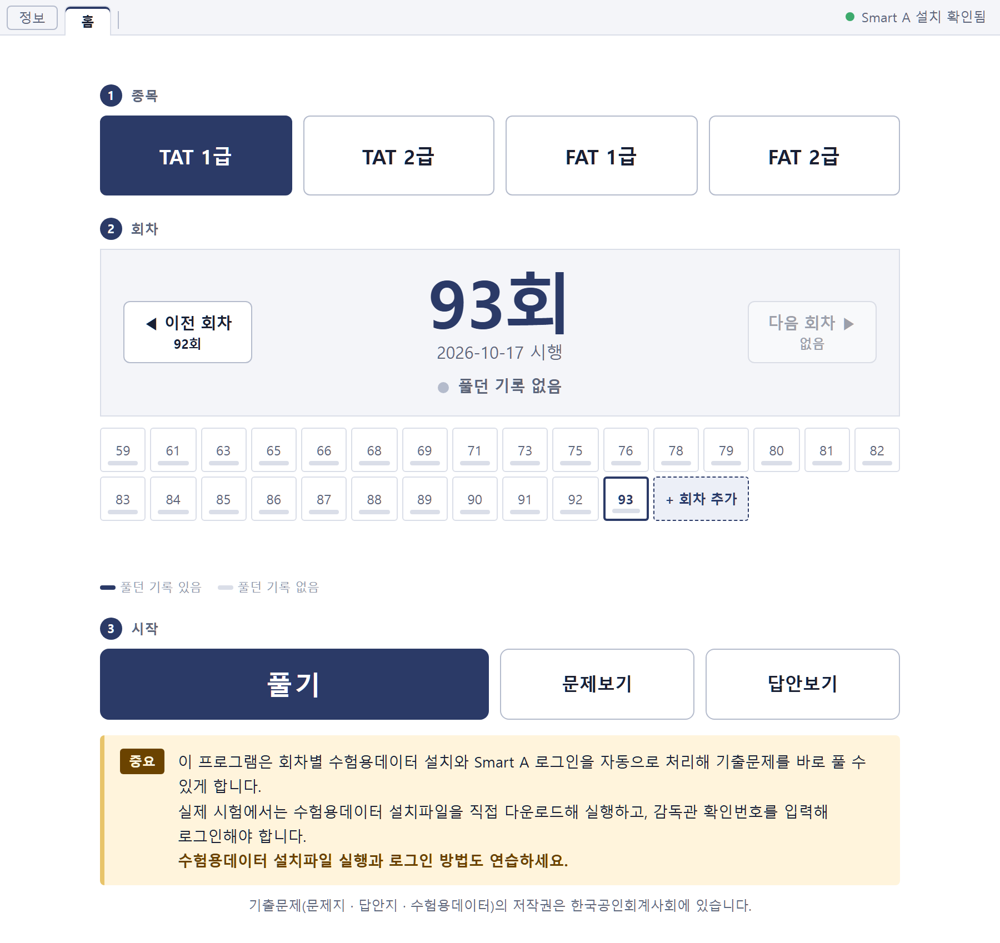

# 기출문제풀기 TAT FAT

TAT(세무실무) · FAT(회계실무) 기출문제 수험용데이터를 회차별로 Smart A 에 바로 설치해 풀 수 있게 하는 Windows 프로그램입니다.

## 하는 일

- 종목과 회차를 선택하고 [풀기] 를 클릭하면 그 회차의 감독관 확인번호 · 진행 순서 · 남은 시간이 표시됩니다.
- [수험용데이터 설치파일 실행] 을 클릭하면 실제 시험과 같은 수험용데이터 설치 창이 열립니다.
- Smart A 로그인 창에 감독관 확인번호를 입력하면 문제를 풀 수 있습니다.
- [문제보기] · [답안보기] 로 문제지와 답안지를 바로 확인합니다.
- 회차 자료는 회차를 처음 열 때 다운로드합니다.
- 목록에 없는 회차는 한국공인회계사회에서 다운로드한 기출문제 파일을 [회차 추가] 에 끌어다 놓아 추가합니다.

## 필요한 것

- Windows 10 (32비트 · 64비트) · Windows 11
- Smart A 교육용 프로그램
  - 한국공인회계사회 AT 자격시험 공식 사이트에서 다운로드해 설치합니다: https://at.kicpa.or.kr/home/help/help06002l.jsp
  - Smart A 가 설치되어 있지 않으면 프로그램 오른쪽 위에 [Smart A 미설치 · 다운로드] 가 표시되고, 클릭하면 위 사이트가 열립니다.

## 설치

1. [최신 설치 파일 다운로드](https://github.com/program-going/gichulpulgi-at/releases/latest) 에서 `.exe` 파일을 다운로드합니다.
2. 다운로드한 파일을 실행하고 설치 화면의 안내대로 진행합니다.
3. 바탕화면의 [기출문제풀기 TAT FAT] 를 실행합니다.

지난 버전은 [Releases](https://github.com/program-going/gichulpulgi-at/releases) 에 있습니다.

## 업데이트

새 버전이 있으면 프로그램을 실행할 때 안내 창이 표시됩니다.

[업데이트] 를 클릭하면 새 버전을 설치하고 프로그램이 다시 실행됩니다.

## 실제 시험과 다른 점

이 프로그램은 회차별 수험용데이터 설치 파일과 감독관 확인번호를 바로 제공합니다.

실제 시험에서는 수험용데이터 설치 파일을 직접 다운로드해 실행하고, 감독관 확인번호를 입력해 로그인해야 합니다.

수험용데이터 설치 파일을 다운로드해 직접 실행하는 방법도 따로 연습하세요.

## 문의

사용 중 궁금한 점이나 오류는 [Issues](https://github.com/program-going/gichulpulgi-at/issues) 에 글로 남겨 주세요.

글을 남기려면 GitHub 로그인이 필요합니다.

## 저작권

- 기출문제(문제지 · 답안지 · 수험용데이터)의 저작권은 한국공인회계사회에 있습니다.
- 프로그램: © 2026 program-going. All rights reserved.
